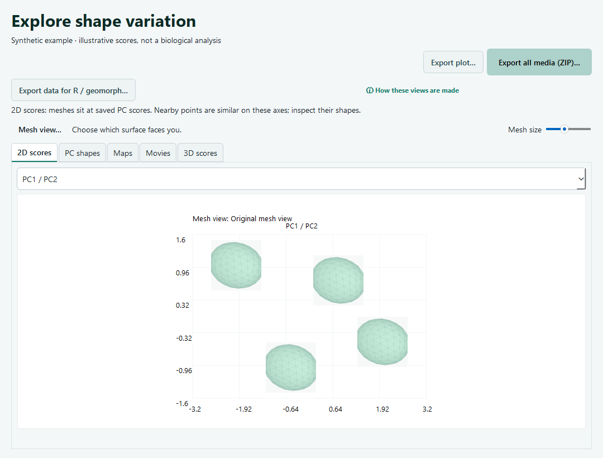

# DiffeoForge

**From 3D surface meshes to reviewed deformation atlases and shape analysis.**

DiffeoForge helps morphology researchers prepare meshes, place homologous
landmarks, review initial alignment, test fits in a guided pilot, and explore
atlas-derived shape variation. The desktop interface and command line share
reproducible configurations and recorded scientific decisions.

> **Pre-alpha research software.** Numerical completion does not establish
> anatomical validity or scientific production readiness. The Deformetrica
> reference route and experimental Modern Engine have separate evidence and
> licensing requirements. See the [validation strategy](docs/VALIDATION_STRATEGY.md).



*Source-interface preview with synthetic meshes and illustrative scores.
Source features and an installed package can differ.*

## Start here

| Your goal | Where to go |
| --- | --- |
| Learn the desktop workflow | [User guide](docs/USER_GUIDE.md) |
| Prepare your first dataset | [First-run workflow](docs/FIRST_RUN.md) |
| Understand template, landmarks and alignment | [Input guidance](docs/USER_GUIDE.md#prepare-and-align) |
| Choose a shape-space method | [Short method guide](docs/USER_GUIDE.md#understand-shape-space-methods) |
| Analyze exported data in R | [R and geomorph handoffs](docs/R_EXPORT.md) |
| Check implementation and qualification | [Continuity](docs/DEVELOPMENT_CONTINUITY.md) · [Roadmap](ROADMAP.md) |
| Report a problem or propose an improvement | [Issue chooser](https://github.com/heinjenny95/DiffeoForge/issues/new/choose) |

## The workflow

1. **Inspect inputs.** Choose meshes, a complete initial template and known units.
   Optional template analysis suggests representative forms for your review.
2. **Align.** Place or import corresponding landmarks, choose how to treat size,
   and inspect the transformed cohort before approving alignment.
3. **Test a pilot.** Compare fitting methods on selected forms. Mark problem areas
   and retain useful earlier fits while reviewing proposed improvements.
4. **Build and review an atlas.** Start a computation explicitly, inspect numerical
   stopping and registration quality, and keep unresolved cases visible.
5. **Explore and export.** View saved PCA scores, PC shapes, maps and movies;
   export media or separate data packages for base R and geomorph.

Originals and completed runs are preserved. A successful computation, an
anatomical review and a biological conclusion remain separate decisions.

## Run from source

Python **3.11 or newer** is required. From a clone of this repository:

```bash
python -m venv .venv
# Activate: .venv\Scripts\Activate.ps1 on Windows, or source .venv/bin/activate
python -m pip install -e ".[desktop,analysis]"
diffeoforge-desktop
```

This installs the source interface and dependencies. A compatible Deformetrica
runtime must be configured separately before reference computations. See
[backend setup](docs/REFERENCE_BACKEND.md),
[Windows distribution scope](docs/DESKTOP_DISTRIBUTION.md) and the
[full command-line reference](docs/ENGINEERING_REFERENCE.md).

The repository contains [public synthetic subjects and a template](docs/SYNTHETIC_DATASET.md)
for reproducible checks. Private study data and installer artifacts are not
distributed through this repository.

## Methods and interpretation

- **Alignment:** homologous landmarks guide orientation. Explicit size policies
  distinguish shape-only analyses from size-and-shape analyses.
- **Surface fitting:** the pilot supports Current/Varifold comparisons and visual
  feedback. Landmarks are not silently added as atlas attachment constraints.
- **Shape space:** the default reference analysis uses the fitted LDDMM tangent
  metric. Cartesian PCA, PCoA and nonlinear alternatives are labelled separately.
- **R handoffs:** saved atlas scores retain their recorded metric and signs.
  geomorph receives supplied landmark coordinates for a separate analysis.

Read [reference PCA methods](docs/REFERENCE_PCA.md),
[alignment policies](docs/PROCRUSTES_ALIGNMENT.md),
[scientific reporting](docs/SCIENTIFIC_ATLAS_REPORT.md) and the
[bibliography](docs/MANUSCRIPT_REFERENCES.md) before interpreting results.
Screenshots and numerical checks do not approve anatomy, inclusion or PCA.

## Contribute

Usability reports, documentation, reproducible bugs and methodological discussion
are welcome. Start with an [issue](https://github.com/heinjenny95/DiffeoForge/issues/new/choose)
and follow the [contribution guide](CONTRIBUTING.md). Use synthetic or licensed
public reproductions.

```bash
python -m pip install -e ".[dev,desktop,analysis]"
ruff check .
pytest
python -m build
```

Technical detail: [architecture](docs/ARCHITECTURE.md),
[engineering reference and documentation catalogue](docs/ENGINEERING_REFERENCE.md),
[release checklist](docs/RELEASE_CHECKLIST.md) and [AI usage](AI_USAGE.md).

## Data and license

Keep unpublished meshes, specimen-level results, checkpoints, sensitive metadata
and credentials out of issues and commits. Public test data need appropriate
provenance and redistribution rights.

DiffeoForge is [MIT licensed](LICENSE). Deformetrica 4.3.0 is a separately licensed,
non-free reference component under the INRIA Non-Commercial License, restricted
to educational, research and evaluation use. Third-party engines, datasets and
dependencies retain their own terms.
